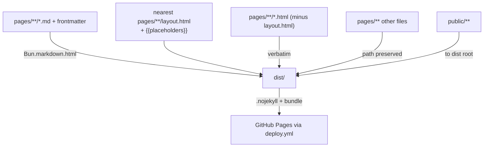

# Repository Guidelines

## Project overview

`quirkdom.github.io` is the personal homepage of **Quirkdom / Abi**, served at
<https://quirkdom.com>. Hand-written HTML and Markdown live under `pages/`, a
single Bun script compiles them into `dist/`, and a GitHub Actions workflow
deploys `dist/` to GitHub Pages. `public/` holds static assets (images, the
stylesheet, the webfont subsets) and is copied verbatim to the **document root**.

There are two things to work on:

1. **Pages** — `pages/**`, plus the assets they load from `public/`.
2. **The font layer** — `public/formose.css`, `public/fonts/*.woff2`,
   `scripts/build-webfonts.sh`, and `typography/`.

Do not invent a third.

## Architecture



Three page styles ship from one tree:

|URL|Source|Layout|
|---|---|---|
|`/`|`pages/index.html`|none — hand-written; its own CSS/JS are bundled|
|`/~abi/`|`pages/~abi/index.md`|`pages/~abi/layout.html` → `/formose.css`|
|`/~abi/<year>/<slug>/`|Markdown|walks up to `pages/~abi/layout.html`|

### `public/` maps to the document root

`public/**` is copied to `dist/**`, so `public/formose.css` is served as
`/formose.css`. This is forced by `formose.css` hardcoding `url("fonts/…")` —
the stylesheet and `fonts/` must be siblings at the root. **Markup under `pages/`
uses root-absolute URLs** (`/formose.css`, `/fonts/…`, `/prof_abi.jpg`), because
a page can sit at any depth. The front page's own CSS/JS are the exception:
relative (`./index.css`) so the bundler can hash them.

> Stale `public/…` hrefs in markup 404 at runtime, not build time — the build
> never validates URLs.

### The front page is hand-written and unlike the rest

- Structure: `div.page-content > header + main > section*`, plus a fixed
  `canvas#aphrodite-canvas` and two module scripts.
- A dark, scrolling layout: `body::before` paints `Mystical-Red-Portal.png` at
  the bottom, and `--bg-clear` (set by `index.mjs`) grows the body so the art
  clears the content. Must stay in sync with the `37.5vw` art height in
  `index.css`.
- **Email obfuscation is an HTML + CSS + JS contract** — all three must agree:

|Layer|Role|
|---|---|
|`pages/index.html`|`<a class="crypt-mail" data-tld data-domain data-user>`, pieces **reversed**|
|`pages/index.css`|`.crypt-mail::after` reassembles them with `direction: rtl`|
|`pages/index.mjs`|reverses the joined string, navigates to `mailto:`|

With JS off the address is still shown (by CSS) and every other link works.

## The build — `scripts/build.ts`

Run from the repo root. Renders Markdown, resolves layouts, then copies.

- **Markdown.** Exactly one `.md` per directory; it becomes that directory's
  `index.html`. Two in one directory is a hard error. A missing layout is a hard
  error. **The build fails loudly; never paper over these.**
- **Frontmatter.** `---`-fenced `key: value` lines, `#` comments allowed, values
  may be quoted. `title`, `date` (`YYYY-MM-DD`), `description`, `draft` are
  recognised; other keys pass through into the interpolation context. A
  malformed line fails the build.
  - `date` present ⇒ a **writing**: listed in the writings index, must have a
    `title` and its own directory.
  - `draft: true` (or `yes`, or `published: false`/`no`) ⇒ excluded from
    production builds. A draft `index.md` makes its whole subtree draft.
- **Layouts.** The nearest `layout.html` in the page's directory or any ancestor
  up to `pages/` wins. **Override, not composition** — a deeper layout replaces
  its ancestor. Layouts are inputs and are never emitted.
- **Placeholders.** `{{content}}` (required), `{{title}}`, `{{dateline}}`,
  `{{descriptionMeta}}`, `{{writings}}`, plus any frontmatter key. Unknown keys
  interpolate to empty; `{{content}}`, `{{dateline}}` and `{{descriptionMeta}}`
  expand to whole elements or nothing.
- **`{{writings}}`.** Every dated page, newest first, grouped under an `<h3>`
  per year. Alone on a line, the wrapping `<p>` is replaced too.
- **Embeds.** `{{embed: ./file.html}}` splices a standalone HTML/SVG/JS file in
  verbatim, shielded from Markdown mangling.
- **Sidenotes.** The build expands each bare `<span class="sidenote">` /
  `<span class="marginnote">` into a `<label class="sidenote-number">` plus an
  associated `<span id>` that `formose.css` styles — no runtime JS. See
  `transformSidenotes`.
- **`_` prefix.** Any file or directory named `_…` is a build input, never
  emitted.
- **Assets.** `public/**` is copied blindly to the root. Non-Markdown files under
  `pages/` keep their paths. In production, assets referenced only by draft pages
  are dropped. Copies are not hashed.

### Bundling

`bundlePageAssets` runs `Bun.build` over every emitted page that references its
**own** CSS/JS with a **relative** URL (`./index.css`): those are minified,
content-hashed into `assets/`, the HTML rewritten, and the unhashed sources
deleted. **Root-absolute** URLs (`/formose.css`, `/fonts/…`) and the CDN bare
imports are marked external and left alone. So every `~abi/` page (which loads
only `/formose.css`) is byte-for-byte untouched, while the front page ships
hashed bundles.

### three.js & Draco, from jsDelivr

`pages/index.html` carries an importmap pinning `three@0.185.0`: the minified
core plus the four addons the viewer imports, with `three/addons/` left as a
fallback prefix for any other addon. The bundler keeps these bare imports
external and the browser fetches them at runtime. The Draco-compressed bust needs
a decoder; the viewer passes `DRACO_GLTF_CONFIG` (three's smaller, glTF-targeted
decoder), whose paths derive from the addon's own CDN URL.

## Commands

```bash
bun run build    # pages/ + public/ -> dist/ (CI runs this; --drafts or DRAFTS=1 to include drafts)
bun run dev      # build with drafts to .dev/, serve with live reload; --host <port>
bun run preview  # build prod dist/ (no drafts), serve statically; --host <port>
bun run fonts    # rebuild the ETbb subsets in public/fonts/
```

- `bun run dev` watches `pages/` and `public/`, rebuilds, and reloads over a
  WebSocket; `.dev/` is git-ignored.
- `bun run fonts` **must** run from the repo root. It reads
  `typography/etbb/opentype/*.otf`, bootstraps `.venv-fonts/` on first run, and
  writes the six ETbb woff2 files plus `LICENSE-ETbb.txt`.
- Font-build knobs: `PYFTSUBSET=/path/to/pyftsubset` (skip the venv),
  `FONT_VENV=/path/to/venv` (override the venv location).
- Agents: pick a free port, e.g. `bun run dev -- --host 8123`.

## Conventions

### `pages/index.html`

- 4-space indent, no tabs, wrap at ~80 columns. Wrapping follows Prettier's HTML
  style even though Prettier is not configured — the signature is the hugged
  closing bracket:

  ```html
  <a href="https://x.com/AbiQuirkdom"> Abi</a>
  ```

- Offsite links are absolute `https://`; `target`/`rel` are never used. Inline
  `style="…"` is normal here.
- Runtime assets use root-absolute URLs (`/fonts/…`, `/prof_abi.jpg`); the page's
  own CSS/JS are relative (`./index.css`) so the bundler can hash them.

### `pages/index.css`

- 4-space indent, one declaration per line. Plain CSS — no preprocessor, no
  `@layer`. `var(--bg-clear)` is the one custom property, set by JS.
- Font faces for **Ioskeley Mono** (Regular/Italic/Bold) live here, with
  root-absolute `/fonts/…` URLs; the stack is
  `"Ioskeley Mono", "Andale Mono", "Lucida Console", monospace`.

### `pages/index.mjs` and `pages/aphrodite-viewer.mjs`

- Page scripts are `.mjs` (the repo sets `"type": "module"`). Both load as
  `<script type="module">` and bundle into one hashed chunk.
- `index.mjs` is plain DOM work: the email click handler and the portal guard. No
  async, no state, no error handling — keep it that way.
- `aphrodite-viewer.mjs` builds the Three.js scene, drag-to-rotate, and the render
  loop; it imports `three`/`three/addons/…` as bare specifiers resolved by the
  importmap. Its top-level `await` is why it must be a module.

### `pages/~abi/layout.html`

- Content sits in `article > section`: Tufte's measure is
  `section > p { width: 55% }`, and paragraphs outside `section` run full width.
- Raw HTML passes through Markdown, which is how sidenotes are written — the span
  must be **inline** inside its paragraph, or it stops being a margin note. Place
  them at clause or sentence boundaries so folded mobile reading flows.

## Font layer

- **`/formose.css`** (the `~abi/` pages) is adapted from `tufte-css` with inputs
  from `latex-css`; its `@font-face` layer is ours. Measure, leading, sidenote
  gutter and dark mode still follow Tufte — do not restyle them.
- ET Bembo is subset from `typography/etbb/opentype/*.otf` by
  `scripts/build-webfonts.sh` into six `-core`/`-ext` woff2 files. ⚠️ The
  `unicode-range` lists in `formose.css` **must stay in sync** with the `core`
  and `ext` variables in that script — change one, change both.
- Never hand-edit a `.otf` or a `.woff2`. Change the ranges/features in the
  script, rerun `bun run fonts`, then update `formose.css`.
- The front page's Ioskeley Mono subsets are committed directly; no script
  produces them.
- **`typography/TYPOGRAPHY.md` is authoritative — read it before touching
  anything font-related.** Never edit the upstream sources under
  `typography/etbb/` by hand.

## Tooling

- **The build has no runtime dependencies.** `scripts/build.ts` imports only
  `node:fs` / `node:path` and uses `Bun.markdown.html` and `Bun.build`.
  `package.json` lists just `@types/bun` (dev) and `typescript` (peer) for editor
  types; `bun.lock` and `node_modules/` exist locally, but CI runs no
  `bun install` and the build does not need them. **Do not add a dependency.**
- `index.ts` is an unused `bun init` stub; `tsconfig.json` only feeds editor types
  (there is no typecheck script).
- No tests, linter, or formatter — verification is manual.
- Shell scripts: `#!/usr/bin/env bash`, `set -euo pipefail`, run from the repo
  root. Python deps install into `.venv-fonts/`, never globally.

## QA before committing

```bash
bun run build
# font binaries are committed: CI copies public/ but never rebuilds fonts,
# so an untracked .woff2 deploys as a 404
git status --short public/fonts/ typography/etbb/
bun run dev   # load http://localhost:8000/
```

- Load the served root in a real browser, not `file://`. Watch the console and
  Network panel: only `-core` woff2 files should load unless a page really uses
  characters outside the core range.
- Test the front-page email link **with and without JS** — the CSS `::after` and
  the JS reverse-decode are separate paths and either can break silently.
- Check the front page at a narrow width: the canvas stacks below the text and
  the portal art still clears the content.
- Check `~abi/` pages below 760px: folded sidenotes render inline.

## Gotchas

1. **The two page styles are deliberately different.** `/formose.css` styles only
   `~abi/`; the front page gets its own bundled CSS. Do not unify them.
2. **The ET Bembo stack order is load-bearing.**
   `font-family: "ET Bembo", "ET Bembo Fallback", …` — `"ET Bembo Fallback"`
   declares regular, bold *and* italic, so putting it first renders the whole page
   in Georgia forever, and it looks plausible because Georgia has oldstyle
   figures. This exact mistake survived a round of testing here.
3. **Font preloads need `crossorigin`.** Font fetches are CORS-mode even
   same-origin; without it the preload is discarded and the file downloads twice.
4. **`~abi` in a shell.** `git add pages/~abi/` is fine mid-word, but `cd ~abi`
   expands `$HOME/abi`. Quote it at the start of a word.
5. **Commit style:** short imperative sentence, no conventional-commit prefix, no
   emoji, no scope tag. Branch off `main`.
6. **Site code is unlicensed.** `public/fonts/LICENSE-ETbb.txt` and
   `typography/etbb/doc/LICENSE` cover the ETbb font binaries (MIT) only.
