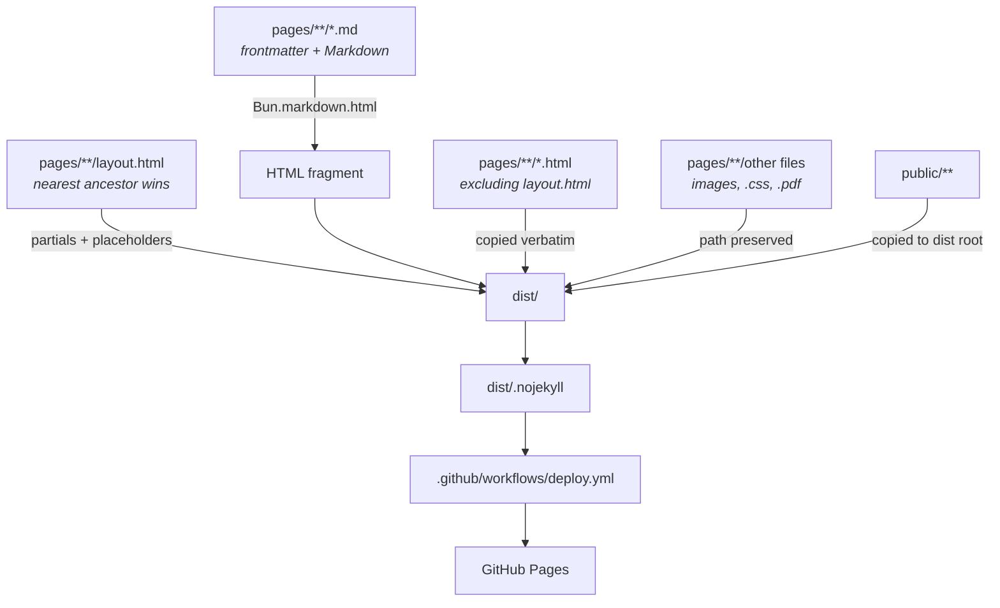

# Repository Guidelines

## Project Overview

`quirkdom.github.io` is the personal homepage of **Quirkdom / Abi**, published at
<https://quirkdom.com>. Pages are authored by hand or in Markdown under
`pages/`, compiled by a single Bun script into `dist/`, and deployed to GitHub
Pages by a GitHub Actions workflow. Static assets and stylesheets live in
`public/`, and the locally built ET Bembo webfont subset ships from there too.

There are exactly two things to work on here:

1. **The pages** — `pages/**` (incl. the front page's `index.css`, `index.mjs`,
   `aphrodite-viewer.mjs`) + `public/{formose.css,…}`.
2. **The font layer** — `public/formose.css` + `public/fonts/*.woff2` + `scripts/`.

Do not invent a third.

---

## Architecture & Data Flow

### Build



**No dependencies.** `package.json` has scripts only — no `dependencies`, no
lockfile, no `bun install` step anywhere. Markdown is rendered by
`Bun.markdown.html`, the front page's own CSS/JS are minified and bundled by the
runtime's built-in `Bun.build`, and everything else is a file copy.

### Runtime

Three distinct page styles ship from one tree:

|URL|Source|Layout|
|---|---|---|
|`/`|`pages/index.html`|none — hand-written; its own CSS/JS are bundled|
|`/~abi/`|`pages/~abi/index.md`|`pages/~abi/layout.html` → `public/formose.css`|
|`/~abi/2026/<slug>/`|markdown|walks up to `pages/~abi/layout.html`|

The front page is a **progressive enhancement**: with JS disabled every link
except the obfuscated email still works, and the address is still displayed —
it is revealed by a CSS `::after` rule, not by JavaScript.

The email obfuscation is a coordinated **HTML + CSS + JS** contract. All three
parts must agree or the contact link breaks:

|Layer|Role|
|---|---|
|`pages/index.html`|`<a class="crypt-mail" data-tld data-domain data-user>` with the pieces **reversed**|
|`pages/index.css`|`.crypt-mail::after` paints them back to human-readable order via `direction: rtl`|
|`pages/index.mjs`|Click handler reverses the joined string and navigates to `mailto:`|

### `public/` maps to the **document root**, not `/public/`

The build copies `public/**` to `dist/**`. So:

|On disk|Served as|
|---|---|
|`public/formose.css`|`/formose.css`|
|`public/prof_abi.jpg`|`/prof_abi.jpg`|
|`public/fonts/ETbb-Regular-core.woff2`|`/fonts/ETbb-Regular-core.woff2`|

This is not a choice, it is forced: `public/formose.css` hardcodes
`url("fonts/ETbb-Regular-core.woff2")`, and that only resolves if the stylesheet
and the font directory are siblings at the root. **Page markup under `pages/`
must use root-absolute URLs** (`/formose.css`, `/fonts/…`), because a post can sit
at any depth. The hand-written `pages/index.html` may use them too.

---

## The build script — `scripts/build.ts`

Run from the repo root. One pass over `pages/`, then a copy pass.

**Markdown.** Exactly one `.md` per directory; it becomes that directory's
`index.html`. Two in one directory is a hard error.

**Frontmatter.** `---`-fenced, one `key: value` per line, `#` comments allowed.
Recognised keys: `title`, `date` (`YYYY-MM-DD`), `description`, `draft` (`true` / `false`).
Anything else is passed through untouched. A malformed line fails the build
rather than being skipped.

- `date` present ⇒ the page is a **writing**. It appears in the writings index,
  and the build requires it to also have a `title` and to live in its own
  directory.
- `date` absent ⇒ an ordinary page, not listed.
- `draft: true` ⇒ excluded from production `bun run build`. Pass `--drafts` to
  `bun run build` or `bun run dev` (or set `DRAFTS=1`) to preview drafts.
  Marking an `index.md` as draft treats all files and subdirectories within that
  folder as drafts too.

**Layouts.** The nearest `layout.html` in the page's own directory or any
ancestor up to `pages/` wins. **Override, not composition** — a deeper layout
replaces its ancestor outright and does not chain to it. No layout anywhere ⇒
hard error. Layouts are build inputs and are never emitted.

**Placeholders** (a layout may use these, and no others):

|Placeholder|Expands to|
|---|---|
|`{{content}}`|the rendered Markdown — **required**, the build fails without it|
|`{{title}}`|frontmatter `title`, HTML-escaped|
|`{{dateline}}`|`<p><time>…</time></p>` if dated, else empty string|
|`{{descriptionMeta}}`|a `<meta name="description">` tag, or empty string|

`{{content}}`, `{{dateline}}` and `{{descriptionMeta}}` each expand to whole
elements or nothing, so an absent value never leaves an empty `<p>` behind.

**Layouts.** The nearest `layout.html` in the page's own directory or any
ancestor up to `pages/` wins. **Override, not composition** — a deeper layout
replaces its ancestor outright and does not chain to it. No layout anywhere ⇒
hard error. Layouts are build inputs and are never emitted.

**Placeholders & Context.** Layouts and pages dynamically interpolate any
`{{key}}` matching frontmatter keys (e.g. `{{title}}`, `{{viewcounts}}`) plus
computed keys (`{{content}}`, `{{dateline}}`, `{{descriptionMeta}}`, `{{writings}}`).

**Interactive Embeds.** Pages can embed standalone HTML/SVG/JS demos via
`{{embed: ./path.html}}`. Embeds are inserted verbatim and protected from
markdown parsing mangling.

**`_` prefix.** Any file or directory whose name starts with `_` is a build
input and is never emitted.

**Assets.** Assets in `public/` are copied blindly to the root of `dist/`. For
non-Markdown files under `pages/`, files are copied with their paths intact; in
production builds, any assets in `pages/` that are referenced by draft pages but
not by any published page are excluded. No hashing, no bundling — a personal
blog does not need cache-busted URLs.

**`{{writings}}`** in a page body is replaced with the generated index of every
dated page, newest first, grouped under an `<h3>` per year. When it appears
alone on a line the build swaps out the whole wrapping `<p>`, because injecting
a heading and list inside one would be invalid nesting.

The build **fails loudly** on bad frontmatter, a missing layout, or a duplicate index.
Never paper over these.

### Bundling

After the copy pass, `bundlePageAssets` in `scripts/build.ts` runs `Bun.build`
over every emitted page that references its **own** CSS/JS with a relative URL
(`./index.css`). Those files are minified, bundled and content-hashed into
`assets/`, the HTML is rewritten in place, and the original unhashed sources are
deleted so only the hashed copies ship.

Opt-in is the **URL shape**, not a config list:

- **relative** `./index.css` → resolved, bundled, hashed, rewritten;
- **root-absolute** `/formose.css`, `/fonts/…`, `/prof_abi.jpg` → left verbatim,
  copied straight from `public/` (a resolver plugin marks `/…` and the CDN bare
  imports as external).

So every `~abi/` page — which loads only the root-absolute `/formose.css` — is
untouched, while the front page gets bundled output. Bun's HTML loader cannot
resolve a root-absolute URL, so **a page that wants bundling must use relative
refs**; it also emits an empty script chunk for a CSS-only page, which the build
prunes. The bundler never minifies HTML itself. Bun folds the entry's path into
a JS chunk's `[hash]` (CSS hashes are purely content-based), so the same JS gets
a different name under a different output directory; in CI the path is stable,
so an unchanged deploy keeps its names.

### three.js & Draco, all from jsDelivr

`pages/index.html` carries an **importmap** pinning `three@0.185.0`. The bundler
leaves those bare specifiers external, so the browser fetches three from
jsDelivr at runtime. To keep it small:

- the core is the minified `build/three.module.min.js`;
- the four addons the viewer imports are mapped to jsDelivr's auto-minified
  `.min.js` builds. The `three/addons/` prefix stays as a fallback for any other
  addon (served unminified), so a new import keeps working without a new entry;
- jsDelivr brotli/gzip-compresses the lot automatically.

The bust is Draco-compressed, so `DRACOLoader` needs a decoder. The viewer hands
it `DRACO_GLTF_CONFIG` — the smaller glTF-targeted decoder three ships — whose
paths derive from the addon's own CDN URL, so there is no three version to keep
in sync.

---

## Key Directories

|Path|Purpose|Editable?|
|---|---|---|
|`pages/`|All page sources. Mirrors the URL path.|✅ Yes|
|`pages/index.html`|The front page. Hand-written, deliberately unlike the rest.|✅ Yes|
|`pages/~abi/layout.html`|Layout for every page under `~abi/`.|✅ Yes|
|`pages/~abi/<year>/<slug>/page.md`|One writing.|✅ Yes|
|`pages/index.css`|Front-page stylesheet. 4-space, no custom properties. Bundled + hashed on build.|✅ Yes|
|`pages/index.mjs`|Front-page email deobfuscation + portal guard. Bundled + hashed.|✅ Yes|
|`pages/aphrodite-viewer.mjs`|Three.js bust viewer. Bundled; `three` stays a CDN bare import.|✅ Yes|
|`public/formose.css`|**Adapted** from upstream tufte-css (with latex-css inputs), `@font-face` layer replaced; diverged enough to take its own name.|⚠️ Font faces + local additions only|
|`public/fonts/`|6 generated `.woff2` + MIT notice.|❌ Generated — rerun the script|
|`public/prof_abi.jpg`|Photo.|✅ Yes|
|`scripts/build.ts`|The page build.|✅ Yes|
|`scripts/build-webfonts.sh`|The font build. Source of the `core`/`ext` ranges.|✅ Yes|
|`typography/etbb/opentype/*.otf`|Font build input. Source of truth. Only 3 of 4 are used; `ETbb-BoldItalic.otf` is dead weight.|✅ Yes|
|`typography/etbb/doc/LICENSE`|MIT text, copied into `public/fonts/`.|✅ Keep intact|
|`typography/etbb/{README,doc/}`|CTAN provenance and the package manual. TeX plumbing already pruned — see `typography/TYPOGRAPHY.md` §6.|✅ Yes|
|`dist/`|Build output. Git-ignored, deployed by CI.|❌ Generated|
|`CNAME`|`quirkdom.com`.|Rarely|

> **Never hand-edit** the upstream font source in `typography/etbb/`. Only
> `opentype/*.otf`, `doc/LICENSE` and `README` are kept, as build inputs; the
> TeX plumbing the CTAN package ships (`afm/`, `tfm/`, `vf/`, `type1/`, `enc/`,
> `tex/`, `map/`) has been pruned. This site has no TeX in it.

---

## Development Commands

No test runner, no linter, no formatter. Four scripts, defined in
`package.json`:

```bash
bun run build   # pages/ + public/ -> dist/   (what CI runs; pass --drafts for drafts)
bun run dev     # build with drafts to .dev/, then serve .dev/ with live reload; use --host <port> with a free port
bun run preview # build prod dist/ without drafts, then serve static pages; use --host <port> with a free port
bun run fonts   # rebuild the webfont subsets (scripts/build-webfonts.sh)
```

`bun run fonts` MUST be run from the repo root. It reads the faces from
`typography/etbb/opentype/`, bootstraps a throwaway venv on first run, and
writes `public/fonts/*.woff2` plus `LICENSE-ETbb.txt`.

Build script knobs:

|Env var / flag|Effect|
|---|---|
|`--drafts` or `DRAFTS=1`|Include draft pages/writings in `bun run build`|
|`PYFTSUBSET=/path/to/pyftsubset`|Use an existing install, skip venv creation|
|`FONT_VENV=/path/to/venv`|Override the venv location (default `.venv-fonts/`)|

Agents: when running the dev server, pick a free custom port (`bun run dev -- --host 8123`) so it does not interfere with other agents.

The TeX plumbing the CTAN package ships (`afm/`, `tfm/`, `vf/`, `type1/`, `enc/`,
`tex/`, `map/`, the `.sty`/`.fd` files) has been pruned — nothing in this repo
ever read it.

---

## Code Conventions & Common Patterns

### HTML — `pages/index.html`

- 4-space indent, no tabs, no max line length; **wrap at ~80 columns**.
- Wrapping follows Prettier's HTML style even though Prettier is not configured
  here. The signature is the hugged closing bracket:

  ```html
  <a href="https://x.com/AbiQuirkdom"> Abi</a>
  ```
  ```html
  <a
      href="https://trezur.quirkdom.com/"
      >
  </a>
  ```
  Match this. It is the single most visible style in the file.
- Structure is `body > header > main > section*`. Each project is one `<li>` in
  the `endeavour` list: a linked logo `` followed by a `<span>` of prose.
- **Asset URLs are root-absolute** (`/fonts/…`, `/prof_abi.jpg`) for the runtime
  assets `public/` serves. The front page's own CSS/JS are the exception: they
  use **relative** refs (`./index.css`) so the bundler can resolve, hash and
  rewrite them. See "Bundling" above.
- Offsite links are absolute `https://`. `target`/`rel` are never used.
- Inline `style="…"` is normal here (`margin-bottom: 2em`,
  `font-size: x-large`) — it is not a mistake to follow.

### The `~abi/` layout — `pages/~abi/layout.html`

Uses formose, so two structural rules matter:

- Content goes in `article > section`. Tufte's measure is written as
  `section > p { width: 55% }`; paragraphs placed directly in `<main>` or in
  `<body>` run the full width of the body and the typography collapses.
- Raw HTML passes through Markdown, which is how sidenotes are written:

  ```html
  Some claim<span class="sidenote">The aside.</span> and on.
  ```

  It must be **inline**, inside the paragraph. On its own line it becomes a
  `<p>` wrapping a `<span>`, and the note loses its position in the margin.
  Because folded notes render inline on mobile without toggles, place them at
  clause or sentence boundaries so mobile reading flows naturally.

  The build expands each `<span class="sidenote">` / `<span class="marginnote">`
  into a `<label>` associated with `<span id="...">` that formose.css styles —
  no runtime JavaScript or checkbox toggles. See `transformSidenotes` in
  `scripts/build.ts`.

### CSS — `pages/index.css`

- 4-space indent, double-quoted font names, one declaration per line.
- **No custom properties, no `@layer`, no preprocessor.** If you find yourself
  wanting a variable, you are probably over-building.
- Class names are short, lowercase, kebab-case, and semantic: `.emoji-aligned`,
  `.prof-pic`, `.crypt-mail`. Element selectors (`section`, `ul`, `li`) are used
  for one-off layout.
- The layout is a flex-centered, single-screen page:
  ```css
  html, body { height: 100%; display: flex; justify-content: center; align-items: center; }
  ```
  Any new content must survive vertical centering with no scrolling.

### CSS — `public/formose.css` (adapted + extended)

- **Adapted from `tufte-css`, with style inputs from `latex-css`.**
  The font layer is ours; measure, leading, sidenote gutter,
  `counter-reset: sidenote-counter` and dark mode still follow upstream Tufte.
  Do not restyle them.
- The `@font-face` block is locally authored: 6 `ET Bembo` faces
  (Regular/Bold/Italic × core/ext) with explicit `unicode-range` and
  `font-display: swap`, plus 3 metric-overridden `local()` fallbacks for
  `"ET Bembo Fallback"`.
- ⚠️ **The `unicode-range` lists must stay in sync** with the `core` and `ext`
  variables in `scripts/build-webfonts.sh`. Change one, change both.

### JavaScript

- Page scripts are **`.mjs`** — explicit ES modules (the repo also sets
  `"type": "module"`, so this is a deliberate signal, not a workaround). Both are
  loaded with `<script type="module">` and bundled together into one hashed chunk.
- `pages/index.mjs` — the front page: one listener per `.crypt-mail` anchor
  (email deobfuscation) plus the portal guard, which now sits at module top level
  (no IIFE). No error handling, because there is nothing to handle: no fetch, no
  async, no state. **Keep it that way.**
- `pages/aphrodite-viewer.mjs` — the Three.js bust viewer. It imports `three` and
  `three/addons/…` as bare specifiers; those stay external and are resolved at
  runtime by the `<script type="importmap">` in `pages/index.html`. Its
  top-level `await` is why it must be a module.
- Sidenotes and marginnotes are authored as bare `<span class="sidenote">` /
  `<span class="marginnote">` in Markdown. The build (`transformSidenotes` in
  `scripts/build.ts`) expands each into an associated `<label>` and `<span>` pair
  that formose.css styles — notes fold cleanly inline on mobile with no runtime
  JavaScript or toggle inputs.
- `scripts/build.ts` — Bun/TypeScript. 4-space indent. Uses `node:fs/promises`
  only; **no dependencies**, so it must stay that way.

---

## Runtime & Tooling Preferences

|Concern|Reality|Constraint|
|---|---|---|
|Runtime|None for the site. Plain HTML/CSS/browser JS.|Do not add a build step or framework.|
|Build runtime|`bun` for pages; `bash` + `python3` (stdlib `venv`) for fonts.|`set -euo pipefail` for shell.|
|Dependencies|**Zero.** No `dependencies`, no lockfile, no `node_modules`.|Do not add one. `Bun.markdown.html` covers Markdown.|
|Package manager|None, by design.|Do not add `bun.lock`, `package-lock.json`, or `requirements.txt`.|
|Python deps|`fonttools`, `brotli`, into `.venv-fonts/` by the script, **not** globally.|Never `pip install` into the system interpreter.|
|Shell|`/usr/bin/env bash`, `#!/usr/bin/env bash` shebang, run from the repo root.||
|Platform|macOS (`.DS_Store` is in `.gitignore`).||
|Git hooks|None. Self-check manually before committing.||

> `bun-plugin-markdown` was evaluated and rejected: version `0.0.0` contains a
> `package.json` and **no `index.js`**, so there is nothing to import.

---

## Testing & QA

No automated tests, linting, formatting, or CI checks other than the deploy
workflow. Verification is manual, and `typography/TYPOGRAPHY.md` is the authoritative record
of the accepted manual procedure for the font layer.

### Before committing

```bash
# 1. Does the build run clean?
bun run build

# 2. Are the font artifacts committed? CI builds dist/ from a fresh checkout,
#    so an untracked .woff2 deploys as a 404.
git status --short public/fonts/ typography/etbb/opentype/ typography/etbb/doc/LICENSE
#    expect: no untracked/modified entries for these

# 3. Does it still look right?
bun run dev   # then load http://localhost:8000/
```

### Manual QA expectations

- Render in a real browser at the served root, not via `file://`.
- Check the console and the Network panel. Only `-core` woff2 files should
  appear unless the page really does contain characters outside the core range.
- Test the front page's email link **with and without JavaScript** — the CSS
  `::after` and the JS reverse-decode are separate paths and either can break
  silently.
- Check the `~abi/` pages **below 760px**: sidenotes must be hidden until their
  marker is clicked. (No runtime JS means the `label[for]` toggle is not
  keyboard-operable — the checkbox is `display: none`. Keyboard accessibility
  is a known gap.)
- Check the front page still fits one screen (`li { max-width: 36em }`).

---

## Important Files

|File|Why it matters|
|---|---|
|`scripts/build.ts`|The page build. Layout resolution, frontmatter, writings index, asset copying.|
|`pages/~abi/layout.html`|The `~abi/` chrome: `<head>`, breadcrumb, `<h1>`, dateline, formose wiring (no `<script>` tag — sidenotes are built, not booted).|
|`pages/index.html`|The front page, hand-written and deliberately unlike `~abi/`.|
|`pages/index.css`|Front-page stylesheet. Bundled + hashed into `assets/`.|
|`pages/index.mjs`|Front-page email deobfuscation + portal guard. Bundled + hashed.|
|`pages/aphrodite-viewer.mjs`|Three.js bust viewer. Bundled; `three` resolved by the importmap.|
|`public/formose.css`|Adapted + patched font layer. Linked by the `~abi/` layout only.|
|`scripts/build-webfonts.sh`|The only font build script. Source of the `core`/`ext` ranges and the feature list.|
|`typography/TYPOGRAPHY.md`|Authority on the font layer. **Read this before touching anything font-related.**|
|`typography/etbb/README`|Upstream CTAN provenance, version 1.057.|
|`typography/etbb/doc/LICENSE`|MIT. Copied verbatim to `public/fonts/LICENSE-ETbb.txt` on every build.|
|`CNAME`|Custom domain.|
|`.gitignore`|`dist/`, `.dev/`, `node_modules/`, `.venv-fonts/`, `.DS_Store`.|

---

## Gotchas

1. **`public/formose.css` is linked — but only from the `~abi/` layout.** The
   front page gets its own CSS bundled from `pages/index.css`, with the
   Ioskeley Mono stack. The two page styles are deliberately different; do not
   "unify" them without being asked.

2. **Root-absolute URLs are served straight from `public/`.** So
   `public/formose.css` is `/formose.css`. Stale `public/…` hrefs in markup will
   404 at runtime, not at build time — the build never validates URLs. And
   because the bundler marks `/…` as external, a page that wants its CSS/JS
   bundled must reference it **relatively**.

3. **The font stack order is load-bearing.**
   ```css
   font-family: "ET Bembo", "ET Bembo Fallback", Palatino, …;
   ```
   `"ET Bembo"` must come first. `"ET Bembo Fallback"` declares regular, bold
   *and* italic faces, so putting it first makes it win every style and the page
   renders in Georgia forever — and it looks plausible, because Georgia has
   oldstyle figures. This exact mistake already survived one round of testing.

4. **Font preloads need `crossorigin`.** Font fetches are CORS-mode even
   same-origin; without the attribute the preload is discarded and the file is
   downloaded twice. See `typography/TYPOGRAPHY.md` §3.

5. **Do not add a `.otf` "fix" by hand.** To change the font, change the
   `core`/`ext` ranges or `features` list in `scripts/build-webfonts.sh` and
   rerun it. Then update the matching `unicode-range` in `public/formose.css`.

6. **`~` in a shell.** `~abi` is a legal URL path segment and is fine mid-word,
   so `git add pages/~abi/` works. But `cd ~abi` or `ls ~abi` will make bash try
   to expand `$HOME/abi`. Quote it if you ever type it at the start of a word.

7. **Commit style:** short imperative sentence, no conventional-commit prefix,
   no emoji, no scope tag. Branch off `main`; `resume-test-1` and
   `resume-test-2` are dead local experiments and not a pattern to imitate.

8. **Site code is unlicensed.** `public/fonts/LICENSE-ETbb.txt` and
   `typography/etbb/doc/LICENSE` cover the ETbb **font binaries only** (MIT). There is no
   root `LICENSE` for the site's own code.
